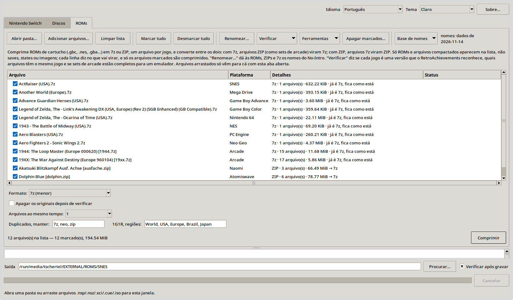

# GameForge

[English](README.md)

**Comprima, verifique e organize cópias de segurança dos jogos que você tem**: Nintendo Switch, consoles de disco e ROMs de cartucho, num app pequeno para Windows e Linux (macOS experimental). Não precisa instalar nada: é um arquivo só e não depende de outras ferramentas.

Versão atual: **2.23.1**. [Download](#download) · [Guia completo](docs/GUIDE.pt-BR.md) · [Novidades](CHANGELOG.md)

> **Novo na 2.21: Relatório da coleção.** Aponte para a sua pasta `ROMS` e receba uma página HTML com todos os seus jogos, por console, com pesquisa e filtros. Ela mostra os jogos que você tem em mais de um console, como *LEGO Star Wars II* no PS2, PSP, GBA e Xbox, ou *Street Fighter Alpha 3* no CPS2 (`sfa3.zip`) e no PS1. Na aba ROMs: **Verificar ▾ → Relatório da coleção**.

## O que ele faz

### Nintendo Switch

- **Junta** o jogo base, a atualização e os DLCs (NSP, NSZ ou XCI) num **arquivo só**.
- **Comprime em NSZ** ao juntar, em geral de 30% a 50% menor. Os instaladores refazem os arquivos originais byte a byte. Também descomprime NSZ de volta para NSP.
- **Verifica cópias**, uma ou a biblioteca inteira de uma vez: calcula o hash de cada arquivo e compara com o que o pacote diz ter.
- **Atualizações e DLCs ▾** compara os seus jogos com uma base de dados online, mostra que atualizações ou DLCs faltam e pode salvar essa lista em CSV.
- **Renomeia** os arquivos para `Nome [TitleID][vVersão].nsp`.

Precisa do seu próprio `prod.keys` na pasta `keys`.

### Discos

Para PS1, PS2, PSP, Saturn, Sega CD, Dreamcast, GameCube, Wii, Xbox e outros:

- **Converte** CUE/BIN, GDI e ISO para **CHD**, também a partir de `.bin.ecm`, `.nrg` do Nero, `.cdi` do DiscJuggler e arquivos ZIP ou 7z, sem descompactar à mão; ISOs para **CSO/ZSO**, discos de GameCube e Wii (também `.wbfs` de Wii) para **RVZ** e discos de Xbox para **XISO**. **Extrair** transforma os CHDs de volta em CUE/BIN, GDI ou ISO.
- **Mostra o que é cada disco**: código do produto, região, versão e o ícone ou a etiqueta do disco.
- **Renomeia** os discos com os nomes do **Redump**.
- **Verifica no RetroAchievements** se a sua versão de cada jogo tem achievements.

### ROMs

- **Comprime** ROMs em **7z** ou **ZIP** (para emuladores que travam com 7z), um arquivo por jogo; recomprime ZIPs de arcade em 7z e transforma arquivos 7z em ZIP.
- **Renomeia** ROMs com os nomes do **No-Intro**, encontra **duplicados** e mantém **uma versão de cada jogo** (1G1R) pela sua ordem de regiões.
- **Relatório da coleção** (novo): uma página HTML com os jogos das suas pastas de console, com campo de pesquisa e filtros, que mostra quais jogos você tem em mais de um console, inclusive sets de arcade.
- **Verifica sets de arcade** para o FBNeo, os cores de MAME do RetroArch e o Flycast (NAOMI, Atomiswave), e diferencia as versões AES e MVS dos jogos de Neo Geo.
- **Verifica no RetroAchievements**. Um clique no status de uma versão não suportada abre a lista das versões que o RetroAchievements aceita, e cada verificação pode gravar um relatório em HTML.
- **Ferramentas** cortam ROMs de Nintendo DS, convertem ROMs de Nintendo 64 para `.z64` e arquivos `.smd` de Mega Drive para `.md`, e removem cabeçalhos de copiadora de SNES e PC Engine. **Verificar ▾ → Checksum do header** diz se ROMs de N64, SNES, Mega Drive e DS conferem com o checksum do cabeçalho.

### Pequenas facilidades

- **Mantém as listas em dia**: se você aceitar, o app procura ao abrir as listas de nomes que você baixou e que ficaram velhas, e pergunta antes de atualizar. Listas que você nunca usou nunca são baixadas.
- **Avisa de versões novas**, com um link no topo da janela. Pergunta antes, e envia só a versão do app e o seu sistema, que o servidor do projeto conta para saber mais ou menos quantas pessoas usam o app ([o que é enviado e guardado](server/README.md)).
- **Lembra onde você estava**: cada aba guarda a própria pasta de saída, e a última aba, o tamanho da janela e as colunas voltam na próxima vez.
- **Renomeia do jeito do RetroArch**: saves, save states e capturas com o nome do jogo são renomeados junto, e as playlists `.m3u` de jogos com vários discos são atualizadas.
- **Mostra os seus jogos**: ícones de jogos de DS, PSP, GameCube e Xbox e os rótulos dos discos de Dreamcast, direto nas listas.
- **Arrastar e soltar** arquivos ou pastas na janela (Windows e Linux): cada arquivo vai para a aba do seu formato.

## Download

Baixe o arquivo do seu sistema em [Releases](https://github.com/tschertel/gameforge/releases/latest), descompacte e execute:

| Sistema | Arquivo |
|---|---|
| Windows (64 bits) | `gameforge-X.Y.Z-windows-amd64.zip` → `gameforge.exe` |
| Linux (64 bits) | `gameforge-X.Y.Z-linux-amd64.tar.gz` → `./gameforge` |
| macOS (experimental, não testado) | `gameforge-X.Y.Z-macos-arm64.tar.gz` (Apple Silicon) ou `-amd64` (Intel) |

Para jogos de Switch, coloque o seu `prod.keys` na pasta `keys`, ao lado do programa. Para discos de Wii, coloque lá também a chave comum do Wii. Imagens de disco e ROMs não precisam de chaves.

## Bom saber

- **Cuidado com os seus arquivos**: os resultados são gravados com um nome temporário e **verificados após gravar**. A renomeação mostra as mudanças antes e nunca escreve por cima de um arquivo. Um original só é substituído ou apagado por uma opção ou ferramenta que diz isso, depois que o arquivo novo é lido de volta.
- **As bases de nomes** (Redump, No-Intro, sets de arcade, RetroAchievements) são baixadas na primeira vez que forem necessárias, depois de perguntar, e ficam numa pasta `cache`.
- **Inglês, português, alemão, francês e espanhol**, com temas claro e escuro.
- **Não inclui jogos nem chaves**: use só com jogos que você tem e chaves do seu próprio console.

## Mais

- **[Guia completo](docs/GUIDE.pt-BR.md)**: todas as opções, formatos de arquivo, configurações e limitações.
- **[Compilar o código](docs/GUIDE.pt-BR.md#compilação)**: Go, sem compilador C.
- **[Histórico de mudanças](CHANGELOG.md)** (em inglês).
- Desenvolvido com o **[Ponytail](https://github.com/DietrichGebert/ponytail)**.

## Licença

[MIT](LICENSE). As licenças de terceiros estão em [THIRD_PARTY_LICENSES.txt](THIRD_PARTY_LICENSES.txt). As bases do Redump e do No-Intro são baixadas pelo app e não fazem parte deste repositório.
