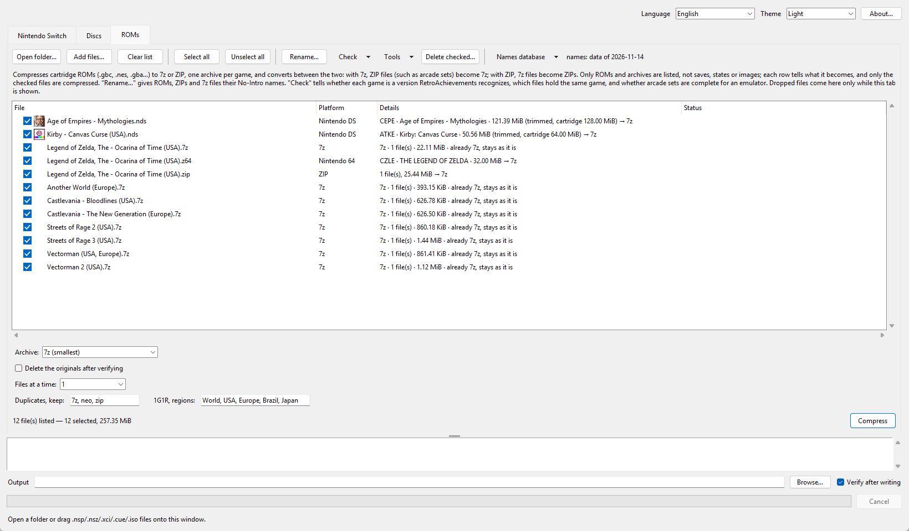

# GameForge guide

[Português (Brasil)](GUIDE.pt-BR.md) · [← Back to the README](../README.md)

A desktop app (Go + Tk, via [modernc.org/tk9.0](https://gitlab.com/cznic/tk9.0)) for Windows and Linux (and, experimentally, macOS) that merges the **base game**, the **update** and the **DLCs** of a Nintendo Switch game (NSP, NSZ or XCI) into a single file, **compressed to NSZ** by default to save space, for backing up the games you own.

Other tabs handle disc images of other consoles: **Discs** (PS1, PS2, Saturn, Sega CD, Dreamcast, PSP, GameCube, Wii, Xbox…: conversion to CHD, or of ISOs to CSO/ZSO, of GameCube and Wii discs to RVZ, of Xbox and Xbox 360 discs to XISO, extraction back to CUE/BIN, GDI or ISO, game information and renaming with Redump names), and **ROMs** compresses cartridge ROMs or recompresses ZIP files to 7z, renames ROMs with their No-Intro names, finds duplicates, checks ROMs against RetroAchievements and checks arcade sets for FBNeo and RetroArch's MAME cores.


**New versions:** the first time it starts, the app asks whether to check once a day for a new version. If you agree, it asks the project's own server for the newest release when it starts (at most once a day, or once a week or a month if you choose) and, when there is a newer one, shows a link to it at the top of the window and a line in the log. The server is a small program on Cloudflare whose code is in the repository ([`server/`](../server/README.md)); it takes the newest release from GitHub. Sent: the app's version, the system and the processor (as `version=2.22.0&os=windows&arch=amd64`, and `GameForge/2.22.0` as the User-Agent); nothing about you or your files, and no ID. Kept: one count of checks per day, version and system, which is how the project knows roughly how many people use the app; not your IP address, and no record of the request. If the server does not answer, the app asks GitHub directly. Nothing is downloaded or installed by itself; without a connection nothing happens. Versions before 2.23.0 asked GitHub only, so whoever turned the check on with one of them is asked again, once. The **Updates** box of the **About…** window chooses how often the app checks (Never, Daily, Weekly or Monthly; `update_check` and `update_every` in `gameforge.json`), shows when the last check was made, and has a **Check now** button, which asks GitHub at once, even with the automatic check off, and tells whether a newer version is out, this one is the newest, or the check failed.

**Old lists:** the first time it starts (also after an update from an older version), the app asks too whether it may look, at startup, for the lists you downloaded that have grown old. If you agree, as often as the check for new versions is set to run (daily if it is off), it looks for old lists: the names of ROMs (No-Intro) and discs (Redump), the lists of arcade sets and the RetroAchievements game lists after 30 days, the Switch game database (titledb) after 14. If there are any, it names them and asks once whether to update them. Only those lists are downloaded again (files that did not change on the server are skipped), and nothing new is downloaded: a list you never used is still only fetched when it is first needed. The RetroAchievements lists are included only when your key is set. The **Updates** box of the **About…** window turns this on or off (`lists_check` in `gameforge.json`; `lists_checked` keeps when the app last asked).

## Download

Ready-made executables for Windows and Linux (64-bit), and experimental ones for macOS (Apple Silicon and Intel, see [macOS](#macos-experimental)), are on the [Releases](https://github.com/tschertel/gameforge/releases) page, with the source code of each version. What changed in each version is in [CHANGELOG.md](../CHANGELOG.md). To build from source, see [Building](#building).

## Tabs

The window has one tab per platform or format: **Nintendo Switch**, **Discs** and **ROMs**. Language, theme, **Verify after writing**, the log, the progress bar and **Cancel** are shared by all of them. The **Output** folder belongs to each tab: opening a folder in a tab (or adding or dropping files) makes that folder the tab's output, so switching between functions needs no new choice; you can still change it by hand, and an empty field writes each result next to its file. Each tab has its own list, with **Open folder…**, **Add files…**, **Clear list** and the button that runs the conversion; nothing is converted just by being added to the list. An opened folder adds only its own files; with **Include subfolders**, a box in the folder dialog of **Open folder…** (off by default), the files in its subfolders are added too. For this box, **Open folder…** always uses the app's own folder dialog, also where the other dialogs are the system's. Dropped folders follow the box's last state. The last tab shown comes back on the next start.

Files dropped on the window (or folders, with their subfolders when **Include subfolders** was last checked) go to the open tab if it accepts the format; otherwise to the default tab for that format: `.nsp`/`.nsz`/`.xci` to Nintendo Switch, and disc images (`.cue`, `.gdi`, `.iso`, `.gcm`, `.chd`, `.cso`, `.zso`, `.rvz`, of any console) to Discs. To compress files to 7z, open the ROMs tab before dropping them (or use its buttons), since it takes files of any extension. If the current tab received nothing, the app switches to the tab that did. Files dropped on the executable itself (or opened with "Open with") are added the same way.

In the conversion tabs, the list has the columns **Platform** (detected from the disc contents), **Details** and **Status**: when you convert, each row shows "Queued", "Converting 43%", "Verifying 80%" and, at the end, the size of the result, how much smaller it is and how long it took, or why it failed ("⏭ already exists", "✗ …", "■ cancelled").

New formats are added to the code as a "converter" (accepted extensions, description of each file, output name and the conversion itself, in `tabs.go`), which gets a tab like the others.

## How it works

An NSP is a PFS0 container with NCA files, a `.cnmt.nca` (metadata), tickets (`.tik`) and certificates (`.cert`). Merging copies all of these files, **unchanged**, into a new NSP holding several titles (base + update + DLC). Files with the same name (identical NCAs, repeated certificates) are stored only once.

`prod.keys` is used only to **read** the metadata: the app decrypts the header and the CNMT of each NSP to get the exact Title ID, type (base/update/DLC) and version. Without `prod.keys`, these are taken from the file name (`Name [0100XXXXXXXXXXXX][v65536].nsp`). The same happens with games released for a newer firmware than your keys: the keys bar shows up to which firmware your `prod.keys` goes, and those files show "needs keys of firmware …". In that case, dump the keys again from an updated console.

### NSZ compression (default)

With **Compress to NSZ** (on by default, needs `prod.keys`), the result is an `.nsz` in the [nsz](https://github.com/nicoboss/nsz) format, accepted by installers such as DBI and Tinfoil:

- The game data NCAs (types *Program* and *PublicData*: the bulk of the game, the update and the DLCs) are decrypted and compressed with zstd in 1 MiB blocks, becoming `.ncz`. The keys to re-encrypt them are stored in the file; the installer rebuilds the original NCA **byte for byte**, with Nintendo's signatures intact.
- Small NCAs (metadata, icon/control, manual), tickets and certificates are copied unchanged.
- The subsection encryption of updates (BKTR) is handled separately, so updates compress well too.
- Delta fragments of updates (*Data* NCAs, used only by the console for incremental updates) are left out, as nsz does.
- The savings depend on the game: games with already compressed data save little, others 30–50%.

Levels: **Fast**, **Normal** (default) and **Maximum** (much slower, small gain).

**Verify after writing** (on by default) reads the written file back, decompresses each NCZ and compares its SHA-256 with that of the original NCA; if anything does not match, the file is deleted and the error is logged. While writing, the hash of each NCA is also compared with its file name (which is the hash itself): if it does not match, the log warns that the source NSP may be corrupt.

Compatibility checked against the official `nsz` 5.0.0: `nsz -D` restores an NSZ made by this app to an NSP identical byte for byte to the uncompressed merge; the app correctly decompresses NSZs made by `nsz`; and the NCZ section tables are identical in both tools.

Without compression, the app writes a plain `.nsp`, just repacking the files.

### Decompress NSZ → NSP

`.nsz` files can be added to the list too. With **Compress to NSZ** off, their NCZs are decompressed and the result is a plain `.nsp` with the original NCAs **byte for byte** (each NCA is named after its hash, and **Verify after writing** checks it). To just convert an NSZ, add the file, turn compression off and click **Merge selected**. Delta fragments that the NSZ dropped stay out (they are not needed to play). **Apply update to the base game** does not read NSZ yet: decompress first.

### XCI (cartridge image)

`.xci` files can be added to the list too. An XCI stores the game's NCAs in the cartridge's *secure* partition (in HFS0, a format similar to PFS0); the app uses those NCAs as if they were an NSP, so an XCI can be converted to NSP/NSZ and merged with updates and DLCs. Cartridge NCAs do not use tickets. XCIs with or without the 0x1000-byte key area at the start work, trimmed ones included. XCZ (compressed XCI) is not supported.

### Updating an already merged file

Since merging changes nothing, the original base game is still inside the merged file. When a new update comes out, you can install it on top on the console or in the emulator, or merge the merged file again with the new update: the list shows what the file already contains (for example, `includes update 1.0.8 (v524288)`) and, when merging, the old update inside it is replaced by the new one (the base and DLCs stay).

Files with the update *built into* the base game (version above 0 on a base game, like the `[patched]` files made by the option below) show as "update … applied, takes no other": an update applies only to the original base game (v0), so the app does not combine them with updates.

### Apply the update to the base game (emulators only)

The **ⓘ** icon next to the option shows a summary of this section when the mouse rests on it.

With **Apply update to the base game**, instead of keeping the base and the update as separate titles, the app writes **a single, already updated base game** (`… [patched].nsp`/`.nsz`). It takes less space than a normal merge, because the parts of the base game that the update replaced are dropped, but it **accepts no further updates**: worth it for games that will not be updated anymore.

- The update's RomFS section (BKTR) is a table that says, for each piece of the new RomFS, whether it comes from the base game or from the update data. The app reads this table and writes the complete resulting RomFS.
- The ExeFS (code), the control data (icon/NACP) and the manuals come from the update; what exists only in the base game (e.g. the logo) is kept. Delta fragments and older updates are ignored. Checked DLCs are added unchanged.
- An already merged NSP (base + update) works as input too: the app uses the base and the update inside it.
- The new NCAs no longer use a ticket (the key goes into the key area) and get a new CNMT, of type *Application*, at the update's version.
- With **Verify after writing**, the app reads the written RomFS back and checks the whole IVFC hash tree: any piece assembled wrongly shows up as an error in the log.
- With **Compress to NSZ** on, the result is compressed afterwards.

**Limits of this option:** Nintendo's RSA signatures are no longer valid. Emulators do not check them; a console would accept the file only with signature patches. It cannot be undone: keep the original files. Games that use sparse or compressed storage (some recent titles) or very large patch tables are not supported yet: the log explains what to do (uncheck **Apply update to the base game**).

By default only the newest update (updates are cumulative) and the newest version of each DLC are checked, but you choose file by file.

### Discs: CHD, game information and names


In the **Discs** tab, `.cue`, `.gdi` and `.iso` files (and the other images below) are added to the list already checked, with the platform, type and size of each. Nothing is converted when adding: check the ones you want and click **Convert to CHD**. The result is MAME's **CHD v5** format, read by DuckStation, PCSX2, Flycast, PPSSPP, RetroArch and MAME. It does not need `prod.keys`. The conversion is done by the app itself, in Go, without `chdman`:

- **`.cue` + `.bin`** → CD CHD (PS1, Saturn, Sega CD, PC Engine CD…), with the same layout as `chdman createcd`: hunks of 8 sectors of 2352 bytes + 96 bytes of subcode, tracks padded to multiples of 4 sectors, audio tracks stored big-endian and one `CHT2` metadata entry per track (with an `INDEX 00` or `PREGAP` pregap). It accepts one `.bin` per track or a single `.bin`. Mode 1 and Mode 2 Form 1 sectors (PS1 data) with intact ECC have their sync and parity removed and regenerated on read, as in current `chdman` (in Mode 2 the header counts as zero when computing the ECC, as the standard says).
- **Dreamcast (GD-ROM)** → GD-ROM CHD (`CHGD` metadata), like `chdman createcd`: both the classic `.gdi` and the multi-track Redump `.cue` (the one with `REM SINGLE-DENSITY AREA` and `REM HIGH-DENSITY AREA`). The high-density area starts at sector 45000, and the space up to it is filled with empty sectors. The layout follows `chdman` 0.289, the released version: in a `.gdi`, the gap to the next track becomes empty sectors at the end of each track; in a Redump `.cue`, each track's pregap moves to the end of the previous track (the `.gdi` layout). The newer, not yet released MAME source replaces part of this padding with pregaps; emulators read both.
- **`.iso`** → **CD** or **DVD** CHD, depending on the game: PS1 images and images up to 737,280,000 bytes (an 80-minute CD, like PS2 games on CD) become CD CHDs (one Mode 1 track, as `chdman createcd` does with an `.iso`); PSP and larger images become DVD CHDs, like `chdman createdvd`. The Details column shows the choice ("→ CD CHD (automatic)"); if it is wrong for a game, right-click the row and choose **Convert as CD** or **Convert as DVD**.
- **Other CD images** become CD CHDs the same way, track by track:
  - **ECM** (`.bin.ecm`, Neill Corlett's format, which drops the sync, EDC and ECC fields of sectors where they can be computed again): it is decoded while converting, without writing a `.bin` first, and the checksum stored in the `.ecm` is checked at the end; a damaged file stops the conversion and leaves no CHD. A `.cue` naming `Game.bin` when only `Game.bin.ecm` is there works as is (the `.ecm` is then not listed by itself). A `.bin.ecm` without a `.cue` is read as one data track. An `.nrg.ecm` or `.cdi.ecm` works too.
  - **NRG** (Nero Burning ROM): disc-at-once (`DAOX`/`DAOI`) and track-at-once (`ETN2`/`ETNF`) images, with each track's pregap.
  - **CDI** (DiscJuggler, all three versions), the usual format of self-booting Dreamcast CD-Rs.
  In NRG and CDI images, subchannel data after each sector (2368- or 2448-byte sectors) is left out, the order of the audio samples is detected, and the gap between two sessions, which these images do not store (on Dreamcast CD-Rs the data session starts at sector 11700 or so), becomes empty sectors, so that every track keeps its place on the disc. The NRG and CDI readers follow the published descriptions of the formats (the NRG one from the former Wikipedia article, the CDI one from no$psx's documentation) and were tested with images built from those descriptions, not with images made by Nero or DiscJuggler: if one is read wrongly, please report it.
- **ZIP and 7z** files holding a disc image (`.cue` with its `.bin` files, `.gdi`, `.iso`, `.nrg`, `.cdi` or `.ecm`) are listed too, with the image's name and the number of files (`Game.cue + 3 other file(s), 650.12 MiB → CHD`); archives of other files (ROMs) are not. When converting, the archive is unpacked into a temporary folder next to the output (so that much free space is needed there), the image inside is converted to `Archive name.chd` (or CSO/ZSO for an ISO, as chosen), and the folder is removed, also after an error or **Cancel**. A GameCube, Wii or Xbox image inside an archive is refused: unpack it and add the image itself.
- **Game information:** the Details column shows what the disc says about the game, before the image details: for example `SCES-00001 · Europe` for Ridge Racer (PS1), `SLUS-21409 · v1.01 · USA` (PS2), or `AEROWINGS · T40201N · v1.002 · USA` (Dreamcast). PSP discs give the title, product code, version, region, disc number and minimum firmware (from `PARAM.SFO`); Dreamcast, Saturn and Sega CD discs the title, product code, version, regions and disc number (from their header); PS1 and PS2 discs only the product code (from `SYSTEM.CNF`), the region it implies and, on PS2, the version: the game's name is not on these discs. GameCube and Wii images show their ID and title. PSP games also show their icon (`ICON0.PNG`) next to the name, in its own proportions, and Dreamcast games in a CHD or GDI their disc label (`0GDTEX.PVR`, the picture printed on the disc), when the disc has one: many early games do not. The names line up even when only some rows have a picture. **CHD files you already have** are listed too, read directly from the CHD (made by this app or by `chdman`, CD, GD-ROM or DVD), with the disc type and track count; they are not converted, but have a checkbox like the other files, for **Rename…** and **Check RetroAchievements**, and right-clicking one offers **Check CHD…**.
- **Rename…** gives the checked CHD, ISO, CSO and Xbox files their [Redump](http://redump.org) names, the usual names of disc backups: `Ridge Racer.chd` → `Ridge Racer (Europe).chd`, `legostarwarsiitheoriginaltrilogy.chd` → `LEGO Star Wars II - The Original Trilogy (USA).chd`. The game is found by the code on the disc (PS1, PS2, PSP, Dreamcast, Saturn, Sega CD, GameCube, Wii and Xbox; on Xbox, the title ID of `default.xbe`, such as `EA-091`, with the regions it runs in). When several entries share a code (other revisions, regions or editions), the regions and, on GameCube and Wii, the revision the disc states decide, then the size of the data track and, only if needed, its CRC, which reads the whole track (about 20 seconds for a 1.1 GB Dreamcast track). If even that does not decide, or the code is unknown, the file keeps its name and the log says why. The names come from the Redump databases published by libretro ([libretro-database](https://github.com/libretro/libretro-database), CC BY-SA 4.0): the first time a console's discs are renamed, the app asks to download its database (a few MB per console; about 13 MB for all nine) and keeps what it uses in `cache/redump.cache`, next to `gameforge.json`. The **Names database ▾** menu updates the databases of all consoles (only files that changed are downloaded again), and the label next to it shows which consoles are there and up to which date they have data, with a hint to update them after 30 days. Without it, PSP, GameCube and Wii discs, which carry their title, are named from it with their region. As with Switch files, the changes are shown before renaming, no file is ever replaced, and every change is logged; `.m3u` playlists in the same folder that list a renamed file are updated, and the RetroArch files named after the game in the same folder follow it (`Ridge Racer.state.auto`, `Ridge Racer.png`, `Ridge Racer.srm`… become `Ridge Racer (Europe).state.auto`…), so saves, states and thumbnails keep working; the preview counts them. `.cue` and `.gdi` images are not renamed (their track files would have to be renamed too): convert them first. An XISO keeps `.xiso.iso` (`Burnout 3 - Takedown (USA).xiso.iso`). Rebuilt as XISO, an Xbox disc no longer has the size and CRC Redump lists, so only its code and regions decide: when a game has several versions for the same region (Burnout 3 has two European ones, with different languages), an XISO keeps its name and the log lists them; a full Redump disc image is told apart by its CRC.
- **Check RetroAchievements** tells, in the status column, whether each checked CHD, ISO, CUE or GDI is a version RetroAchievements recognizes, for PS1, PS2, PSP, Dreamcast, Saturn and Sega CD discs, as the button of the ROMs tab does for cartridges (same API key, lists and cache). The console is the one the disc tells, and the hash follows rcheevos: the boot executable named in `SYSTEM.CNF` with its name (PS1, PS2), `PARAM.SFO` and `EBOOT.BIN` (PSP), the start of `IP.BIN` and the boot file (Dreamcast, found in the last track of a GD-ROM), or the disc's first 512 bytes (Saturn, Sega CD). Only those files are read, so a disc takes a fraction of a second, even in a CHD. Dreamcast discs in a Redump `.cue` are not checked: convert them to CHD first.
- **Platform:** the app recognizes PS1 and PS2 (by `SYSTEM.CNF`), PSP (`UMD_DATA.BIN`/`PSP_GAME`), Saturn, Sega CD and Dreamcast (by the Sega header in the first sector), 3DO, Neo Geo CD (`IPL.TXT`) and PC Engine CD; audio-only CDs show "Audio CD". GameCube and Wii images are recognized too.
- **`.m3u` playlist:** with **Create .m3u playlists for games on several discs** (on by default), when converting discs named like `Game (Disc 1)`, `Game (Disc 2)` (also `Disk`, `CD2` or `Disc 2 of 3`), the app writes `Game.m3u` in the output folder listing that game's CHDs found there, in order. Opening the `.m3u` in RetroArch or DuckStation lets you change discs while playing. A playlist that is already up to date is not rewritten.
- Each hunk is compressed with every codec and the smallest result is kept. On CD: `cdlz` (LZMA), `cdzl` (deflate) and `cdfl` (FLAC, for audio tracks), like `chdman`; on DVD: `lzma` and `zlib`. All CHD readers support these codecs. CHDs made by `chdman` with the zstd codecs (`cdzs`, `zstd`, `chdman -c`) are read too: listed, checked, extracted, renamed and checked against RetroAchievements. FLAC is implemented in the app: fixed predictors (order 0 to 4) and linear prediction (LPC, up to order 12, with coefficients from autocorrelation and Levinson-Durbin over Tukey windows), a choice between independent stereo, left/side, side/right and mid/side by the real size of each option, and Rice codes per partition. Repeated hunks (e.g. empty areas) are stored only once.
- **Verify after writing** reads the CHD back, decompresses every hunk and checks each one's CRC and the SHA-1 stored in the header; if anything does not match, the file is deleted. The tab's **Check CHD…** button checks a `.chd` you already have, including ones made by `chdman` (the app reads the `cdlz`, `cdzl`, `cdfl`, `lzma`, `zlib`, `huff` and `flac` codecs; it does not read `cdzs`/`zstd` or CHDs with a parent file). Some CHDs found in collections have every hunk intact (each matches its CRC) but a data SHA-1 in the header that is not the SHA-1 of their data; `chdman verify` fails them the same way. The check then says so, with both SHA-1s: the header is wrong, or the data was changed after the CHD was made, so extract the disc and compare its tracks with Redump to know whether the data is good.
- **Extract** (next to **Convert**) writes the checked CHDs back as the images they were made from, next to them or in the output folder, and keeps the CHD: a CD becomes a `.cue` with one `.bin` per track, named and laid out as Redump's (`Game (Track 1).bin`; a track's pregap stored in the CHD goes at the start of its file, after `INDEX 00`, and one that is not stored becomes a `PREGAP` line); a Dreamcast GD-ROM becomes a `.gdi` with its track files, the high-density area at sector 45000; a DVD (PS2, PSP) or a CD made from an ISO becomes an `.iso`. A right click on a CD with one data track offers an ISO instead (only the 2048 bytes of data of each sector are kept, as for Open PS2 Loader), and on a CD made from an ISO a CUE + BIN. Existing files are never written over. With **Verify after writing**, each file is read back and its SHA-1 compared with what was written; the CHD's own hunks are always checked by their CRC while reading. Checked with real discs: the data tracks of PS1, Saturn and Dreamcast discs and a PSP ISO extracted from CHDs have Redump's CRCs, and a CUE/BIN or GDI converted to CHD and extracted again is identical to the original, sheet included.

Compatibility checked against the official `chdman` 0.289: `chdman verify` accepts the CHDs made by the app (FLAC hunks included); the data SHA-1 **and** the overall SHA-1 (which includes the track metadata) are identical to those of a CHD made by `chdman createcd`/`createdvd` from the same input (including an `.iso` converted as CD, a `.gdi` and a Dreamcast `.cue`); and `chdman extractcd` returns the same CUE/BIN from both. The other way round, the app reads and verifies CHDs made by `chdman`.

**Limits:**

- The size is practically the same as `chdman`'s, with an identical SHA-1. On real data-only PS1 games: Colony Wars (Disc 1), 347.3 MB vs. 346.9 MB (+0.1%), and X-Men vs. Street Fighter, 227.26 MB vs. 227.53 MB (−0.1%). On games with CD audio tracks: Ridge Racer, 310.38 MB vs. 309.91 MB (+0.15%), and Ridge Racer Revolution, 530.28 MB vs. 529.55 MB (+0.14%); without FLAC linear prediction (LPC) they were 4.9% and 4.3% larger. The small remaining difference comes from the Go LZMA encoder, which compresses slightly less than 7-Zip's, and from libFLAC details. On DVD the difference is about 2%, because the app does not write the `huff` and `flac` codecs that `chdman` also tries.
- `.cue` files with WAV tracks and CHD → CUE/BIN conversion are not supported.

### Discs: Xbox images to XISO

In the **Discs** tab, Xbox and Xbox 360 `.iso` images (for example, Redump ones) become `Name.xiso.iso`, the format that xemu, Xenia and modded consoles load (emulators do not read Xbox CHDs). Images that are already an XISO are listed for what they are, to rename them, and not converted again. (Before 2.16.0 this was a tab of its own, **Xbox → XISO**; if it was the tab shown last, the app opens the Discs tab with that tab's output folder.)

- A disc image has a video partition followed by the game partition, in an XDVDFS file system; sectors not used by any file are filled with random data. The app finds the game partition (Xbox: XGD1; Xbox 360: XGD2 and XGD3) and rewrites only the directory tables and the files, one after the other, like `extract-xiso -r`. An image that is already an XISO is accepted too and rewritten without slack space.
- The result is usually much smaller than the original image (about 7.3 GB on Xbox and more on Xbox 360).
- The original directory tables are kept (only the position of each file changes), and the file contents are copied unchanged: unlike `extract-xiso`, the app does **not** apply the "media check" patch to the `.xbe` files.
- With **Verify after writing**, the app reads the written XISO back and compares each file's SHA-1 with the original's; if anything does not match, the file is deleted.
- The list shows the platform, the image type (XGD1/XGD2/XGD3 disc image or XISO), the number of files and the total game data. Xbox games show their title image (the picture of the console's game list, from `default.xbe`) next to their name, and the title, title ID and regions from the certificate of `default.xbe` (the title there is often shortened, or empty); Xbox 360 games show none.

### Discs: GameCube and Wii to RVZ

In the **Discs** tab, GameCube and Wii disc images (`.iso`, `.gcm`) become **RVZ**, Dolphin's compressed format; the choice of CHD, CSO or ZSO for ISOs does not apply to them. It does not need `prod.keys`. (Before 2.16.0 this was a tab of its own, **GameCube/Wii → RVZ**; if it was the tab shown last, the app opens the Discs tab with that tab's output folder.) The RVZ options are on the second row below the list, after **GameCube/Wii → RVZ:**.

**WBFS images** (`.wbfs`, the format of Wii USB loaders such as USB Loader GX and WiiFlow) are listed too, with the game ID, title, the image's size and the disc's, and become RVZ the same way (with the Wii common key), read as the disc they hold: no `.iso` is written first. An image split into parts for FAT32 drives (`game.wbfs`, `game.wbf1`, `game.wbf2`…) is read as one, and **Rename…** renames the parts with it. A WBFS image leaves out the parts of the disc the game does not use; they become zeros, which RVZ stores in almost no space. So the RVZ plays the same, but it is not identical to an RVZ made from a full Redump dump, and **Rename…** finds a WBFS image by its game ID and revision only (as for an XISO): when Redump lists several versions with that ID, the file keeps its name and the log lists them.

- GameCube discs contain a lot of pseudo-random padding (sometimes more than half the disc), which no compressor can shrink. RVZ finds the seed of the generator that produced that padding and stores only the seed (68 bytes in place of each piece), and compresses the rest with Zstandard at the library's highest level. To find the padding right after each file, the app reads the disc's file table (FST). The generator and the seed recovery are a translation of Dolphin code that is in the public domain (CC0); the rest follows the format specification (Dolphin's `docs/WiaAndRvz.md`).
- The list shows the platform, the ID and the title of the game.
- **Wii:** the disc partitions are encrypted and have hash trees (H0/H1/H2) every 32 KiB. RVZ stores the data **decrypted and without the hashes**, which makes the random padding recognizable and the rest compressible; the reader (Dolphin) recomputes the hashes and encrypts again with each partition's key, which is stored in the RVZ. Where the original hash differs from the recomputed one (discs with unusual hashes), RVZ stores the original ("exceptions"), so the ISO comes back identical byte for byte. The partition table, the tickets and the rest of the disc outside the partitions are stored as raw data.
- **Wii common key:** to convert a Wii ISO to RVZ, the app has to decrypt each partition's key, and for that it uses the **Wii common key**, which the app **does not contain**: put yours in the `keys` folder as `wii_common_key.bin` (16 bytes) or `wii_common_key.txt` (32 hex digits), or choose the file with **Wii common key: Browse…** below the list. Korean discs use the Korean key (`wii_korean_key.bin`, next to it). Without the key, Wii discs are grayed out; if the key does not decrypt the disc, the app says so before writing. GameCube needs no key.
- **Block size** (below the list): 128 KiB (default, as Dolphin suggests), 512 KiB, 1 MiB or 2 MiB. Larger blocks make smaller files, but the emulator decompresses the whole block every time it reads a new piece. 128 KiB is the safest for handhelds and weak CPUs; 1 or 2 MiB save space for playing on a PC. The compression level does not matter when playing: Zstandard decompresses at practically the same speed at any level.
- With **Verify after writing**, the app decompresses the written RVZ and compares its SHA-1 with the original image's.
- Compatibility checked with `DolphinTool` from Dolphin 2609b, on GameCube and Wii: Dolphin converts the app's RVZ back to an ISO identical to the original (on Wii, recomputing hashes and encryption on its own), and the app reads RVZs made by Dolphin (also checked with real Super Smash Bros. Melee and Mario Kart Wii discs, with 2 MiB blocks).
- GameCube games show their banner (the 96 × 32 image of the console's menu, from `opening.bnr` on the disc) next to their name, for ISO, GCM and RVZ files; for an RVZ, only the chunks holding the file table and the banner are decompressed. Wii discs show none yet.
- **Rename…** gives the checked ISO, GCM and RVZ files their Redump names, as for the other discs: `melee.rvz` → `Super Smash Bros. Melee (USA) (En,Ja) (Rev 2).rvz`. RVZ files are listed for this (with the game ID, title and image size, read from the RVZ header without decompressing), but not converted. The game is found by its game ID, and between entries by the region, the revision on the disc and the image size; only if that does not decide is the CRC computed, which for an RVZ decompresses the whole disc. The GameCube and Wii databases are downloaded once when needed, like the others; RetroArch files and `.m3u` playlists follow renamed files.
- Size on real games, compared with Dolphin (Zstandard level 5, 128 KiB blocks): with 128 KiB blocks the app is practically the same (+0.2% to +0.9%); with 1 MiB, 1.5% to 5.8% smaller; with 2 MiB, 2.1% to 7.1% smaller (Pikmin, Melee, Wind Waker, Mario Kart Wii and Super Mario Galaxy).

### Discs: ISO to CSO/ZSO

In the **Discs** tab, `.iso` images (PSP, PS2 and others with 2048-byte sectors) can be compressed to **CSO** or **ZSO** instead of CHD, formats that loaders and emulators read directly, without decompressing first. (Before 2.16.0 this was a tab of its own, **ISO → CSO/ZSO**; if it was the tab shown last, the app opens the Discs tab with CSO or ZSO chosen and that tab's output folder.)

- **ISO to:** below the list chooses **CHD** (the default), **CSO** or **ZSO** for the ISOs of the list; `.cue` and `.gdi` images always become CHD. **CSO** uses deflate and is the most widely supported (PPSSPP, PCSX2, Open PS2 Loader, PSP with custom firmware). **ZSO** uses LZ4: it compresses a little less but decompresses much faster, which helps on real hardware; check that your loader or emulator reads ZSO.
- `.cso` and `.zso` files are listed too, with the game information of the image inside (title, product code, PSP icon), and **Rename…** and **Check RetroAchievements** work on them as on an ISO. **Extract** writes them back as the `.iso`.
- The file is written in version 1 of the format, with 2048-byte blocks; each block is compressed separately (deflate at the highest level or LZ4 HC) and, if it does not shrink, stored uncompressed. Images over 2 GiB use the index shift that the format provides.
- With **Verify after writing**, the app decompresses the written file and compares its SHA-1 with the original image's; if it does not match, the file is deleted.

### ROMs: compress to 7z, rename, find duplicates, check against RetroAchievements, check arcade sets



In the **ROMs** tab, each file becomes its own `.7z`, with the same name: cartridge ROMs (`Game (USA).gbc` → `Game (USA).7z`) or ZIP files, such as arcade sets, which become a 7z with the same files inside, with the same names and dates. When the arcade lists were downloaded (**Check ▾ → Sets for…**), arcade sets are listed by their titles, with the file name in brackets: `Street Fighter Alpha 3 (USA 980904) [sfa3.zip]`. It does not need `prod.keys`.

**Archive: 7z or ZIP.** 7z files are the smallest, but some emulators that list 7z among their formats crash or fail on it. With **Archive: ZIP**, each file becomes a `.zip` instead (Deflate at the highest level), about 15 to 35 percent larger than a 7z but much faster to write and opened by almost every emulator. 7z files in the list then become ZIPs with the same files and dates (with **Delete the originals after verifying**, the 7z goes once the ZIP is checked), and ZIP files are left as they are.

- **Which files:** the tab lists only games: cartridge ROMs of the consoles the No-Intro lists cover (`.gbc`, `.nes`, `.sfc`, `.md`, `.a52`…), and ZIP and 7z archives. Saves, states, thumbnails, playlists, patches and notes next to them are left out. A `.bin` is listed as a cartridge ROM (Mega Drive, Atari…) unless a CUE or GDI sheet is in the same folder, as it is then a disc's track. The **Platform** column shows the console, for ZIP and 7z files too (from the ROMs inside them); an arcade set found in the downloaded arcade lists shows **Arcade**, or **Naomi**, **Naomi 2**, **Atomiswave** or **Sega System SP** for Flycast's games (the lists do not name the board of the others); any other ZIP or 7z shows its format. Each row tells what it becomes (`→ 7z`, `→ ZIP`, or `already 7z, stays as it is`), and only the checked files are compressed.
- **Compression:** LZMA, from the LZMA SDK's encoder (the one inside 7-Zip) ported to Go, at 7-Zip's normal level (5), in one solid stream per archive. Higher levels only enlarge the dictionary beyond the size of a ROM: on an 18 MB file, 7-Zip's highest level was 0.13% smaller than its normal level. The result is practically the size of 7-Zip's (11.48 MB against 11.44 MB on that file; a ZIP at the highest level had 12.35 MB), but the Go encoder is about 1.5 to 3.5 times slower than 7-Zip on one thread, around 1 to 2 MB per second: a few seconds for a typical cartridge ROM or arcade set, but around half a minute for a 32 MB GBA ROM.
- **ZIP:** files compressed with deflate or stored are read; password-protected ZIPs and other methods are refused with the reason. Each file's CRC is checked against the ZIP's (MAME and FBNeo identify ROMs by it).
- **Delete the originals after verifying:** removes each original once its 7z is written, read back and compared with it, which always happens with this option, even with **Verify after writing** off. If the check fails, the original stays. On Windows the originals go to the Recycle Bin (when a file cannot go there, because it is larger than the Recycle Bin or the drive has none, as some USB and network drives, Windows asks before deleting it for good, and a No keeps it); on Linux and macOS they are deleted.
- **Files at a time:** how many files are compressed at once (1 by default). The 7z compressor uses one processor core per file, so several at a time finish sooner, though not by the full factor, since the cores share the memory and the processor's power: on a laptop processor with 12 threads (2 performance and 8 efficiency cores), four 90 MB Neo Geo games took 2 minutes at a time against about 70 seconds each one after the other (4 minutes 40 seconds). The list offers up to 8 (no more than the processor's threads) and marks as recommended half the threads, up to 4. Each file being compressed takes about 100 MB of memory. On a slow drive (an SD card, a USB stick, a network folder) the drive may become the limit, and more files at a time gain little; the amount written is the same either way. The log lines of the files come in between, each error line names its file, and the progress bar shows the whole batch.
- **RetroArch:** save states and thumbnails are named after the game without the extension, so they keep working with the `.7z`. Playlists (`.lpl`) store the file name with its old extension: scan the folder again in RetroArch. FBNeo and MAME read 7z directly; for other cores, RetroArch extracts the game to a temporary folder first.
- With **Verify after writing**, the app reads the archive back, decompresses every file and compares its size and CRC with what was written.
- Compatibility checked with 7-Zip 26: `7z t` accepts the archives and `7z x` extracts the original files, including folders inside a ZIP, empty files and non-ASCII names; the app's reader also opens 7-Zip's archives with a plain header.
- Nintendo DS ROMs show their icon (the 32 × 32 picture of the DS menu, from the ROM's banner) next to their name, loose or in a ZIP or 7z. In a 7z only the start of the ROM is decompressed, in the background, so the icon appears a moment after the list. Loose DS ROMs also show their game code, their title from the banner and, when trimmed, the size of their cartridge: `AMHE · Metroid Prime Hunters · 63.01 MiB (trimmed, cartridge 64.00 MiB) → 7z`.
- **Tools ▾ → Nintendo DS: trim checked ROMs** cuts the empty space after the game from the checked loose `.nds` files. A DS ROM is as large as its cartridge (a power of two), and after the game the rest is filled with 0xFF: from a few percent to a quarter or more of the file, depending on the game (a 64 MB Kirby: Canvas Curse becomes 50.6 MB, a 64 MB Metroid Prime Hunters 63 MB). The header tells how much is used (at 0x80, or at 0x210 for games with DSi features); the Download Play signature after it is kept, and only 0xFF bytes are cut: if anything else is there, the ROM is left as it is and the log says so. **Nintendo DS: restore checked ROMs to full size** fills the ROM with 0xFF up to its cartridge's size again, giving back exactly the original file. The files are replaced in place, after the new ones are read back and compared with what was written. Trimming saves space on SD cards and flash carts; inside a 7z the padding takes almost nothing anyway. **Rename…** and the duplicate check recognize trimmed ROMs, loose or in a ZIP or 7z: the CRC of the ROM at its full size follows from the CRC of the trimmed one, without reading it again. The RetroAchievements hash of a DS game does not depend on trimming.
- **Rename…** gives the checked ROMs, ZIPs and 7z files their [No-Intro](https://no-intro.org) names, the usual names of cartridge backups: `pokemon crystal.gbc` → `Pokemon - Crystal Version (USA, Europe) (Rev 1).gbc`, `pkmn.zip` → `Pokemon - Crystal Version (USA, Europe) (Rev 1).zip`. Cartridges carry no reliable game code, so the ROM is found by its CRC-32 and size: for ZIP and 7z files they come from the archive's header, without unpacking (7z files are listed in the tab for this, but not compressed again; the app reads 7-Zip's own archives too); loose ROMs are read once. A ROM with a header that is not part of the cartridge, or in another byte order, is also found: NES (iNES), Famicom Disk System (fwNES), Lynx and Atari 7800 headers, SNES and PC Engine copier headers, Mega Drive ROMs in the interleaved `.smd` format, and Nintendo 64 `.v64` and `.n64` files; inside a 7z, such a ROM is decompressed for this, since the CRC in the archive's header is that of the file as it is. Only the file is renamed, keeping its extension; the ROM inside an archive keeps its name, and nothing is recompressed. Notes and images inside an archive (such as a download site's `.txt`) do not count; archives with more than one ROM file, such as arcade sets (`sf2.zip`, `ffight.zip`), are never renamed, because MAME and FBNeo find the game by that short name; ROMs that are not in the database (hacks, translations, homebrew, bad dumps) keep their names too, and the log says why for each. The names come from the No-Intro databases published by libretro ([libretro-database](https://github.com/libretro/libretro-database)), for 29 consoles (Nintendo from Game Boy to DS, Sega from SG-1000 to 32X, PC Engine, WonderSwan, Neo Geo Pocket, Atari, ColecoVision, Intellivision, Vectrex), plus libretro's own list of Neo Geo games in the single-file `.neo` format (NeoSD, MiSTer, Geolith), whose names the emulators do not depend on: `sonicwi2.zip` holding `sonicwi2.neo` → `Aero Fighters 2 - Sonic Wings 2.zip` (Western and Japanese titles are joined by " - "; the `.neo` inside keeps its short name). The first time a console's ROMs are renamed, the app asks to download its database and keeps what it uses in `cache/nointro.cache`, next to `gameforge.json`; the **Names database ▾** menu updates all of them (about 12 MB). As in the Discs tab, the changes are shown before renaming, no file is ever replaced, every change is logged, and the RetroArch files named after the game follow it (`pokemon crystal.srm` → `Pokemon - Crystal Version (USA, Europe) (Rev 1).srm`…).
- Loose Nintendo 64 ROMs show their game code, the title from their header and their revision: `CZLE · THE LEGEND OF ZELDA (Rev 2) · 32.00 MiB → 7z`; a `.v64` or `.n64` also shows its byte order. **Tools ▾ → Nintendo 64: convert checked ROMs to .z64** writes the checked `.v64` files (bytes swapped in pairs, from the Doctor V64) and `.n64` files (4-byte words reversed) as `.z64`, the cartridge's own order, which No-Intro lists. The emulators (RetroArch's Mupen64Plus-Next and ParaLLEl N64 among them) read all three orders, so this is only for the collection: a loose `.v64` is recognized by **Rename…** anyway, but inside a ZIP or 7z the app only has the archive's CRC, which is that of the swapped ROM. Each ROM is written next to it as `name.z64` (never over an existing file), read back, and then the original is removed (to the Recycle Bin on Windows); saves and states named after the game keep working, and RetroArch playlists are updated.
- **Tools ▾ → Mega Drive: convert checked .smd files to .md** writes the checked `.smd` files (the format of the Super Magic Drive copier: a 512-byte header with `AA BB` at offset 8, then each 16 KiB of the ROM as its odd bytes followed by its even ones) as plain `.md` ROMs, the form No-Intro lists and every emulator reads, and removes the originals once the new files are read back, as for the Nintendo 64 conversion. Files named `.smd` that are already plain are left alone.
- **Tools ▾ → SNES and PC Engine: remove the copier header** removes the 512-byte header that copiers added before the ROM, from the checked SNES (`.sfc`, `.smc`, `.swc`, `.fig`) and PC Engine (`.pce`) ROMs that have one, told by the size (512 bytes over a multiple of 1 KiB on SNES, 8 KiB on PC Engine). The ROM itself does not change. A `.smc`, `.swc` or `.fig` becomes `.sfc` (saves, states and RetroArch playlists follow it); other files are replaced in place, after the new file is read back.
- **Check ▾ → Header checksums (N64, SNES, Mega Drive, DS)** checks, for each checked ROM (loose or alone in a ZIP or 7z), the checksum in its own header against the ROM: Nintendo 64 CRC1 and CRC2 (of the first MiB after the boot code, with the seed of the cartridge's lockout chip, known by the boot code), the SNES internal checksum (the sum of all bytes, the part after the largest power of two repeated as on the cartridge; LoROM, HiROM and ExHiROM headers, with or without a copier header), the Mega Drive checksum (the sum of the words from 0x200, also for `.smd`) and the CRC-16 of the Nintendo DS header. The status column shows `✓ SNES: checksum OK` or `✗ SNES: checksum differs`, and the log gives both values. A ROM that does not match was changed (a hack, a translation, a bad dump), or was released that way, as a few games were: in the collection this was tested with, 17 of 18 verified SNES ROMs match, and Street Fighter Alpha 2 (USA) is off by one. Only what the check needs is read: a DS header, the first MiB of an N64 ROM, a whole SNES or Mega Drive ROM. Other consoles show `– no header checksum`.
- **Check ▾ → Duplicates** looks for the checked ROMs, ZIPs and 7z files that hold the same game, such as a Neo Geo game as `Blazing Star.neo`, as `Blazing Star.7z` and as MAME's `blazstar.zip`. Files count as the same game when the No-Intro database gives them the same name (found by the ROM's CRC, as for **Rename…**, so `pokemon crystal.gbc` and `Pokemon - Crystal Version (USA, Europe) (Rev 1).zip` match), when they hold the same ROM (for ROMs the database does not know), or when they have the same name and are for the same console. MAME's Neo Geo sets, with many files inside, are found by their short names in libretro's Neo Geo list: `blazstar.zip` is Blazing Star. Different versions of a game (another region, revision or board) are not duplicates. Of each game, one file stays: the first format in the order of the **Duplicates, keep** option at the bottom of the tab (by default `7z, neo, zip`: a 7z, with the `.neo` inside for Neo Geo, then a loose `.neo`, then a ZIP such as MAME's set, then any other format); among files of the same format, the one that already has the database name, then the largest. The status column shows `⧉ Keep: Blazing Star (3 files)` on that file, `⧉ Extra copy (keeping Blazing Star.7z)` on the others and `– no duplicate` on the files with no copy, and the log lists each group with the files' sizes and, at the end, how many files are extra and how much space they take. The app then offers to check only the extra copies, unchecking all the rest; **Check ▾ → Duplicates: check only the extra copies** does the same at any time later, with the last check's result (or runs the check first, without asking, if there was none or files left the list since). Look over the list, change the checks if you like, and click **Delete checked…**. Nothing is deleted by the check itself. The databases are downloaded on demand, as for **Rename…**; a Neo Geo list downloaded before version 2.12.0 has no short names and is downloaded again.
- **Check ▾ → 1G1R: one version of each game, by region** (one game, one ROM) keeps one version of each game among the checked ROMs, ZIPs and 7z files: of `Game (Japan)`, `Game (Europe)` and `Game (USA) (Rev 1)`, the one from the first region in **1G1R, regions** at the bottom of the tab (by default `World, USA, Europe, Brazil, Japan`). Versions are told by their No-Intro names, found by the ROM's CRC as for **Rename…** (the databases are downloaded on demand), or, for ROMs the databases do not know, by the file's own name when it has a region in parentheses. A version for several regions, such as `(USA, Europe)`, counts for its best one; betas, prototypes, demos, samples, kiosk and pirate versions and bad dumps (`[b]`) are kept only when a game has nothing else; among versions of the same region the latest revision stays (`Rev 1`, `Rev A`, `v1.1`), then the first format in **Duplicates, keep**, then the largest file. The status column shows `★ 1G1R: keep (of 3 versions)`, `1G1R: other version (keeping …)`, `– 1G1R: only version`, or `– 1G1R: no region` for files without one (and arcade sets), which are left out; the log lists each game with several versions. The app then offers to check only the other versions, unchecking all the rest, for **Delete checked…**; nothing is deleted by the check itself. A game is found by its title, with its disc, disk, side or part (`(Disc 2)`, `(Side B)`), so each disc of a game is kept; versions with different titles in different regions (`Pocket Monsters` and `Pokemon`) count as different games: libretro's No-Intro lists do not tell which versions belong together.
- **Check ▾ → Collection report (games on several consoles)…** asks for the folder that holds one folder per console (such as `ROMS`, with `PS2`, `PSP`, `gba`…), lists the games in all of them (also in subfolders, such as a folder per game) and saves `GameForge - Collection - date.html` in that folder; a message shows where. Each console folder is a console, named as the folder. A game is found by its name: the title before the No-Intro or Redump flags, so `Game (USA)` and `Game (Europe)`, the tracks and the discs of a game are one entry; upper and lower case, punctuation and "The" do not count, so `Game - Part II`, `Game, Part II` and `The Game` and `Game, The` are the same. When the arcade lists were downloaded, an arcade set named by its short name (`sfa3.zip`) counts by its title (`Street Fighter Alpha 3`), so it is found next to the same game on consoles. Only game files count (the formats the app reads: cartridge ROMs, disc images, Switch files, ZIP and 7z; a `.bin` only with flags in its name), so saves, states, images, playlists and the files emulators keep next to the games (such as Dolphin's `User` folder) are left out, as are hidden files and folders and, when the arcade lists were downloaded, BIOS sets (`neogeo.zip`). The page lists each game with its console and the other consoles that have it (**Also on**); a search field (names and consoles), a console filter and **Only games on 2 or more consoles** find the games you have twice. Nothing is read from the files, so a large collection takes seconds. Games named differently on each console (`Pocket Monsters` and `Pokemon`) count as different games.
- **Delete checked…** deletes the checked files of the list, after showing them with their total size and asking (No is the default answer). On Windows they go to the Recycle Bin (when a file cannot go there, because it is larger than the Recycle Bin or the drive has none, as some USB and network drives, Windows asks before deleting it for good, and a No keeps it); on Linux and macOS they are deleted for good. RetroArch saves and states named after the game are not deleted, since the copy that stays uses them. Each file deleted is logged, with the space freed at the end.
- **Check ▾ → Neo Geo .neo games (Geolith)** checks the checked `.neo` files (a whole Neo Geo game in one file, as the Geolith core and the NeoSD cartridge use it), loose or alone in a ZIP or 7z, against libretro's Neo Geo list by their CRC (read from a 7z's or ZIP's header; a loose `.neo` is read whole), downloaded on demand as for **Rename…**. The names of the list come from MAME and often carry the cartridge's product code, which tells the version: NGH for the home console (AES), NGM for the arcade board (MVS). The status column shows `✓ Neo Geo: AES (NGH)`, `✓ Neo Geo: MVS (NGM)`, `✓ Neo Geo: AES and MVS (same ROMs)` for a game whose name has both codes, `✓ Neo Geo: no NGH/NGM code` (most games, which have one known version) or `✗ Neo Geo: unknown CRC` for a file the list does not know (another version, a hack or a bad copy); the log gives each game's name. **Neo Geo: check the MVS versions that have an AES version** runs the same check, then checks, for **Delete checked…**, the arcade versions of the games the folder also has as a home version (by the product number: `(NGM-2420)` when `(NGH-2420)` is there); **Neo Geo: check the AES versions that have an MVS version** does the opposite, for those who prefer the arcade versions. All other files are unchecked; games with only one version here, games with both codes and games with no code are never checked, so no game leaves the collection.
- **Check ▾ → Sets for FBNeo** and **Sets for MAME 2000 / 2003 / 2003-Plus / 2010 / 2015 / 2016** check the checked ZIPs and 7z files as arcade sets of [FBNeo](https://github.com/finalburnneo/FBNeo) or of one of RetroArch's MAME cores, which load each game from an archive named after the game's short name (`blazstar.zip`). Each core follows an older MAME version (MAME 2003-Plus is MAME 0.78 with additions, MAME 2016 is 0.174), and a set made for one version often lacks files or has other ones in another, so the set has to match the core. The lists of sets come from GitHub, downloaded the first time each is used and kept in `cache/arcade.cache`; **Names database ▾** updates those already downloaded:

  | Menu entry | List | Download |
  |---|---|---|
  | Sets for FBNeo | FBNeo's own `FinalBurn Neo (ClrMame Pro XML, Arcade only).dat` (8,532 sets) | about 14 MB |
  | Sets for MAME 2000 | libretro's `MAME 2000 XML.dat` (0.37b5, 2,241 sets) | 2 MB |
  | Sets for MAME 2003 | `MAME 2003 XML.xml` (0.78, 4,721 sets) | 19 MB |
  | Sets for MAME 2003-Plus | `MAME 2003-Plus XML.xml` (4,874 sets) | 20 MB |
  | Sets for MAME 2010 | `MAME 2010 XML.xml` (0.139, 8,833 sets) | 43 MB |
  | Sets for MAME 2015 | `MAME 2015 XML.zip` (0.160, 30,906 machines) | 10 MB |
  | Sets for MAME 2016 | `MAME 2016 XML (Arcade Only).xml` (0.174, 32,071 machines) | 53 MB |
  | Sets for Flycast (Naomi, Atomiswave) | Flycast's table of games, `core/hw/naomi/naomi_roms.cpp` in its source (362 sets, Naomi, Naomi 2 and Atomiswave), read as data | about 300 KB |

  The status column and the log tell:
  - `✓ FBNeo: Blazing Star` when every file of the set is there with the right CRC and size, in the archive itself or in its parent and BIOS sets in the same folder (non-merged, split and merged sets all work); the log names the other sets used, such as `(+ neogeo.zip)`;
  - `⚠ FBNeo: … (complete, but the game does not run well)` when FBNeo marks the game's driver as not working well;
  - `✗ FBNeo: 2 file(s) missing, 1 with another CRC` when files are missing or differ (usually a set made for another MAME version than the one FBNeo follows), or `needs blazstar.zip in this folder` when a clone's parent set, whose files it uses, is not in the folder;
  - `? FBNeo: unknown name, looks like blazstar` when the list has no set of the archive's name but its files are those of a set (an archive renamed by hand), `– FBNeo: .neo file, not an arcade set` for a ZIP or 7z holding a `.neo` file (a whole Neo Geo game in one file, as the Geolith core and the NeoSD cartridge use it, which cannot be checked against a list of arcade sets; the log tells whether libretro's Neo Geo list, used by **Rename…**, knows its CRC, if that list is downloaded), and `– FBNeo: not in the list` otherwise (cartridge ROMs, Naomi and Atomiswave games, which FBNeo does not run).
  Only the archives' headers are read, so a folder of hundreds of sets takes a second or two. The CHDs a set needs (MAME's hard disks and CDs, the GD-ROMs of Naomi games) are looked for where the emulators look for them, `name.chd` in a folder named after the set (or its parent) next to the archive, such as `ikaruga/gdl-0010.chd`; a missing CHD shows as `needs the CHD ikaruga/gdl-0010.chd`. Only their presence is checked, not their contents. The ROMs of MAME's devices, which newer MAME versions keep in sets of their own, are not checked. Flycast, which runs Naomi, Naomi 2 and Atomiswave games, publishes no list of sets, so the app downloads its table of games and reads the names, parents, BIOS sets and files (sizes and CRCs, which come from MAME) from it; nothing of Flycast is built into GameForge. The app looks only in the folder of the ROMs, never elsewhere, and needs no BIOS: a BIOS set (`neogeo.zip`, `naomi.zip`, `awbios.zip`…) is not part of the game, so the check covers the game's own files. If the BIOS is in the folder, its files are checked too and the log shows `(+ neogeo.zip)`; if not, the game still counts as complete and the log only notes that it also uses that BIOS, whose files were not checked. Nothing is changed, and missing files are not looked for elsewhere: sets are not rebuilt.
- **Check ▾ → RetroAchievements** tells, in the status column, whether each checked ROM, ZIP or 7z is a version [RetroAchievements](https://retroachievements.org) recognizes, so that its achievements work in RetroArch: `✓ RA: Pokemon Crystal Version (53 achievements)`, `✓ RA: … (no achievements yet)` or `✗ RA: version not recognized`. When RetroAchievements has the game but not this version (for example only the European release), the status says `✗ RA: only another version is supported`, followed by the address of the page with the supported versions: a click on the status opens it in the browser, and the log has the address too; names are compared without punctuation, "the" and the region and language parentheses (`God of War - Chains of Olympus (USA)` matches `God of War: Chains of Olympus`). It does not look at your progress. The app computes the hash RetroAchievements identifies a game by, with its rules per console (the whole file for most consoles; NES, Famicom Disk System, Lynx, Atari 7800, SNES and PC Engine without their extra header; Nintendo 64 in `.z64` byte order; parts of the ROM on the DS, as rcheevos does), unpacking ZIPs and 7z files for it, and looks it up in the game lists of the RetroAchievements web API. The API needs your own **web API key**: the first time, the app asks for it (after logging in to retroachievements.org, it is in the settings of your account, under Keys); it is kept only in `gameforge.json` and sent only to RetroAchievements, and the **Names database ▾** menu changes or removes it. The lists of the consoles in the tab are downloaded when needed and kept in `retroachievements.cache`; the menu updates them. Archives with several files (arcade sets) and ROMs whose extension does not tell the console (such as `.bin`) are not checked. The log has the hash of each version not recognized, to compare with the game's page on RetroAchievements. With **Check ▾ → Save an HTML report of each RetroAchievements check** turned on (it is off by default; in the Discs tab, the same choice is in **Names database ▾**), a **report** is saved after each check for each console next to the checked files (in the folder of the first one): an HTML page named after the console and the day, such as `RetroAchievements - SNES - 2026-11-22.html` (a second check on the same day gets ` (2)`), with every file, its result, a link to the game on RetroAchievements or, for a version not supported, to the hashes it accepts, and its hash; the log tells where it is. A search box and a drop-down at the top show only some files: those with problems (another version supported, version not recognized or not checked), one of those results, or the recognized ones.

## Usage

The steps below are for the **Nintendo Switch** tab; the other tabs work the same way, with their own conversion buttons.

1. Put `prod.keys` in the `keys/` folder (next to the executable). It is loaded automatically; the app also looks for the last file used, `prod.keys` next to the executable and `~/.switch/prod.keys`. Or click **Browse…**.
2. Click **Open folder…** (or, on Windows, drop a folder on the window). Opening a folder **replaces** the current list and clears the log; with **Include subfolders** its subfolders are read too. In the folder dialog, just select the folder and click OK (no need to go into it). Use **Add files…** (or drop files, on Windows) to add single files without clearing the list. `.nsp`, `.nsz` and `.xci` files are read (other dropped formats go to their own tabs).
3. The list shows each game with all its files (base, updates, DLCs). With `prod.keys`, the game's name and icon, the readable version (for example, `1.0.8 (v524288)`) and the minimum firmware required come from the NSP itself; the name is also used for the output file. The base, the newest update and the newest version of each DLC come checked; click the checkbox (or select the row and press space) to check or uncheck. The game's checkbox checks/unchecks all its files. **Select defaults** and **Unselect all** help with long lists. Files with exactly the same contents as another (for example, the same update downloaded twice, or an NSP and its compressed NSZ) are grayed out as "identical copy of …" and not checked.
4. Check the output folder (it becomes the folder you opened; change it if you like, or empty it to write next to each game's first file) and click **Merge selected**. One file (`.nsz` or `.nsp`) is written per game with checked files.

While writing and verifying, the status line shows the progress, the speed and the time left (estimated from the speed so far, after the first few seconds).

The window's size and position (or whether it was maximized), the list's column widths and the position of the divider between the list and the log are remembered from one run to the next. If the window was on a monitor that is no longer connected, it comes back centered.

The file is written as `.part` and renamed only when finished, so cancelling never leaves a broken file. The output is named `Name [AppID][vVersion][N DLC].nsz` (or `.nsp`).

The merged file needs an installer that accepts several titles in one file and, for NSZ, the NSZ format (for example, DBI and Tinfoil). Emulator support for NSZ varies. To get back to a plain NSP, see [Decompress NSZ → NSP](#decompress-nsz--nsp). **Keep the originals** until you have confirmed that the merged file installs and runs.

## Check a backup

**Check backup ▾** checks `.nsp`, `.nsz` and `.xci` files you already have, without changing them: **Choose files…** opens one or more files, and **Checked files in the list** checks the files checked in the list (open your library folder with **Include subfolders** to check all of it). Each file is checked for being still intact:

- each NCA is read completely (NCZs are decompressed) and its SHA-256 is compared with the one recorded in the metadata (CNMT); NCAs not listed by any CNMT are compared with their own name, which is the hash. Since the hash covers every byte, this also covers the internal hash trees (IVFC);
- everything the metadata lists must be in the file (delta fragments may be missing: they are not needed to play, and NSZ drops them);
- every NCA that needs a ticket must have its ticket in the file.

The result is shown in the log ("everything intact" or the list of problems). With several files, a summary at the end tells how many are intact and names the others; **Cancel** stops after the file being checked. Without `prod.keys` only the file names can be checked.

## Online check (titledb)

The **Updates and DLCs ▾** button (Nintendo Switch tab) compares the games with checked files with [titledb](https://github.com/blawar/titledb), a public database of Switch games:

- **Update game database** downloads from GitHub the update versions of all games (`versions.json`) and the English catalog with game and DLC names (`US.en.json`), about 90 MB. The app keeps only what it uses in `cache/titledb.cache` (about 1 MB), next to `gameforge.json`. All downloaded databases are in the `cache` folder (older versions kept them next to `gameforge.json`; they are moved there at startup). On a new download, files that did not change on the server are not downloaded again.
- **Check the listed games** shows in the log, for each game, whether there is an update newer than the one you have (counting one inside a merged file or one applied to a base game), which DLCs are missing and which DLCs have a newer version. If the database has not been downloaded yet, the app says so and asks whether to download it.
- **Export what is missing (CSV)…** saves the same comparison as a CSV file, one row per game with a checked file that lacks something: game, title ID, your update, the latest update and its date, how many DLCs are missing and their names, and how many DLCs are outdated and their names. Games that are up to date or not in the database are left out. The file opens in Excel or any spreadsheet: its columns are separated by commas when the app is in English and by semicolons in the other languages, as Excel expects in those regions.
- With the database loaded, each game's details column shows a summary: "updates and DLCs up to date (online)", "newer update available: v655360 from 2026-05-12 • 2 DLCs not in the folder" or "not in the online database".

The internet is used only when you choose **Update game database**; the check runs on your computer, without sending anything about your games. Next to the button, the tab shows the state of the database: not downloaded yet, or up to which date it has data, with a hint to update it if it is more than 14 days old. None of this is written to the log when the app starts. The date matters because titledb is updated by volunteers every few weeks, so very recent updates may not be there yet.

DLCs come from the US catalog: DLCs released only in other regions (for example, only in Japan) do not show as missing, and a game that is not in this catalog shows as "no data" if it has no updates listed either.

## Rename Switch files

The **Rename…** button in the Nintendo Switch tab gives the checked files their standard names, useful when a name was wrong or incomplete at dump time:

- Base game: `Game Name [0100XXXXXXXX0000][v0].nsp` (an already merged NSP also gets the update version and `[n DLC]`, like the files the app writes).
- Update: `Game Name [0100XXXXXXXX0800][v196608].nsp`.
- DLC: `Game Name - DLC Name [0100XXXXXXXXX001][v0].nsp`.

The game name is the official one, read from the file itself (needs `prod.keys`); without it, it comes from the game database (**Updates and DLCs ▾ → Update game database**). DLC names come from the game database. `:` becomes ` - `, symbols such as ™ are removed and characters not allowed on Windows become `_`. The extension (`.nsp`, `.nsz`, `.xci`) does not change. Before renaming, the app shows the "current name → new name" list and asks for confirmation; a file never replaces another one with the same name, and every change is logged.

## Saving the log

With **Save the log of each run to a file**, in the **About** window, what each run writes to the log (merging, converting, checking, renaming…) is also saved as a text file named with the date and time, such as `GameForge - 2026-11-26 09-30-05.txt`, in the `logs` folder next to `gameforge.json`. It is off by default, as the log holds the names of your files and folders.

## Theme

The **Theme** selector, next to the language, has **Automatic** (follows the Windows light/dark mode; light on Linux and macOS), **Light** and **Dark**. The change is immediate. With the dark theme, the title bar is dark on Windows too; Windows' native message boxes stay light.

## File dialogs

On Linux (and on Windows when the app's language differs from the system's), the app uses Tk's own file and folder dialogs. They hide hidden files and folders (names starting with a dot, such as `.cache` or `.config`, and on Windows also those with the hidden attribute) and have a **Show Hidden Files and Directories** check box (**Show Hidden Directories** in the folder dialog); its state is remembered (`show_hidden` in the configuration). The native Windows dialogs follow Explorer's setting.

## Language

The interface is available in English, Portuguese, German, French and Spanish. By default ("Automatic") it follows the system language; if that is not one of these, it uses English. Change it with the **Language** selector in the top right corner; the window is redrawn at once, without losing the list or the log, and the messages already in the log switch to the new language too. The open file/folder dialogs follow the chosen language as well: on Linux they are drawn by Tk itself, which is translated into all five languages; on Windows the app uses the native dialogs when the chosen language is the system's and, when it is not (the native ones always use the Windows language), the translated Tk dialogs.

## Configuration

The options are stored in `gameforge.json`, in the program folder (next to the executable; with `go run`, in the current folder). The file is created on the first run (an `nspmerge.json` from when the app was called NSP Merge is renamed to `gameforge.json`, and its options are kept) and updated whenever you change something:

```json
{
  "language": "auto",
  "theme": "auto",
  "keys_path": "C:\\games\\gameforge\\keys\\prod.keys",
  "output_dir": "",
  "last_dir": "",
  "format": "nsz",
  "level": "normal",
  "skip_verify": false,
  "apply_update": false,
  "window": "1184x721+360+160",
  "columns": [460, 620],
  "divider": 330,
  "tab": "switch"
}
```

- `language`: `auto`, `en`, `pt`, `de`, `fr` or `es`.
- `theme`: `auto`, `light` or `dark`.
- `keys_path`: the last `prod.keys` loaded (the `keys/` folder takes priority).
- `output_dirs`: output folder of each tab (`switch`, `chd`, `xiso`, `rvz`, `ciso`, `7z`); empty = next to each file. `output_dir`, from older versions, is used for tabs without one.
- `last_dir`: last folder opened in the dialogs.
- `format`: `nsz` (compressed) or `nsp`.
- `level`: `fast`, `normal` or `max`.
- `skip_verify`: `true` turns off verification after writing.
- `apply_update`: `true` applies the update to the base game (emulators only).
- `tab`: the last tab shown (`switch`, `chd`, `xiso`, `rvz`, `ciso` or `7z`).
- `chd_no_m3u`: `true` turns off `.m3u` playlists for games on several discs.
- `iso_format`: what the Discs tab converts ISOs to: empty (CHD, the default), `cso` or `zso`.
- `rvz_chunk_kib`: RVZ block size in KiB (`128`, `512`, `1024` or `2048`; default `128`).
- `wii_key_path`: the Wii common key file chosen with **Browse…** (the `keys` folder is searched too).
- `sevenzip_exts`: extensions checked (`true`) or unchecked (`false`) in the ROMs tab; the others follow the defaults.
- `sevenzip_delete`: `true` deletes the originals after their 7z is verified.
- `dupes_keep`: the order of the formats kept of a game's duplicates in the ROMs tab, such as `"zip, 7z"`; empty or missing is `7z, neo, zip`.
- `region_order`: the order of regions for 1G1R in the ROMs tab, such as `"Europe, USA, Japan"`; empty or missing is `World, USA, Europe, Brazil, Japan`.
- `show_hidden`: `true` shows hidden files and folders in Tk's file dialogs (Linux).
- `retroachievements_key`: your RetroAchievements web API key, to check ROMs; the file is readable by your user only (Linux).
- `ra_report`: `true` saves an HTML report of each RetroAchievements check; missing or `false` (the default) saves none.
- `window`, `maximized`, `columns`, `divider`: window layout on the last run (saved on close; delete them to go back to the defaults).

If the program folder is not writable (for example, installed in `/usr/bin`), the file goes to the user's configuration folder (`~/.config/gameforge/` on Linux, `~/Library/Application Support/gameforge/` on macOS, `%AppData%\gameforge\` on Windows). The `keys/` folder is also created automatically if it does not exist.

## Building

Only Go 1.27+ is needed: Tk is used without CGO (the Tcl/Tk libraries are embedded in the executable and extracted on the first run to the user's cache folder). No C compiler is needed, and you can build for Linux from Windows and vice versa.

### Windows

```powershell
./build.ps1
```

or by hand, with the flag that avoids the console window:

```bash
CGO_ENABLED=0 go build -ldflags "-H windowsgui -s -w" -o gameforge.exe .
```

If the executable is built without that flag (for example, a plain `go build`), the app closes the console window right after starting; it may still flash for a moment.

The `.exe` icon comes from the `rsrc_windows_*.syso` files, which `go build` includes automatically. The drawing is in `internal/icon` (the window uses it too); if it changes, regenerate the `.syso` files with `go run ./tools/mkicon`.

### Linux

```bash
./build.sh
```

or `CGO_ENABLED=0 GOOS=linux GOARCH=amd64 go build -ldflags "-s -w" -o gameforge .` on any system. To run, Linux needs an X11 (or XWayland) desktop with the `libX11`, `libXss`, `libXft` and `libfontconfig` libraries, which any desktop already installs.

### macOS (experimental)

```bash
CGO_ENABLED=0 GOOS=darwin GOARCH=arm64 go build -ldflags "-s -w" -o gameforge .
```

for Apple Silicon (M1 and later), or `GOARCH=amd64` for Intel Macs, on any system. The macOS builds are compiled from the same code but have not been tested on a Mac: they may have problems the Windows and Linux builds do not, and reports are welcome. They are not signed or notarized by Apple, so macOS blocks a downloaded copy the first time it is opened; allow it in **System Settings → Privacy & Security → Open Anyway**, or run `xattr -d com.apple.quarantine gameforge` in its folder. As on Linux, there is no drag and drop, the automatic theme is light, and deleted originals do not go to the Trash.

### Tests

```bash
go test ./internal/...
```

The tests build synthetic NSPs with random keys (NCA with an AES-XTS header, AES-CTR section via key area and via title key/ticket) and check the analysis, the merge and the NCZ compression (including the BKTR sections of updates) with byte-for-byte round trips.

The CHD conversion has round-trip tests with synthetic images and a compatibility test with MAME's `chdman`, which runs only when the `CHDMAN` variable points to the executable (`chdman.exe` comes with the MAME package for Windows):

```bash
CHDMAN=/path/to/chdman.exe go test ./internal/chd -run Chdman -v
```

It converts the same images with the app and with `chdman`, runs `chdman verify` on the app's CHD, compares the data SHA-1 and the overall SHA-1, checks that `chdman extractcd`/`extractdvd` returns identical images and that the app reads `chdman`'s CHDs (codecs `cdfl`, `huff` and `flac`, and `cdzs` and `zstd` when asked for). There is also a round-trip test of the FLAC encoder/decoder.

The RVZ conversion is tested with a synthetic GameCube disc (files, file table and generator padding with one seed per 32 KiB block) and a synthetic Wii disc (partition table, ticket with the title key encrypted with a test common key, data with an FST, files and padding, a hash tree with some hashes altered to require exceptions, AES encryption): seed recovery at several positions, byte-for-byte round trip, final size, and the errors with no key and with a wrong key. A compatibility test with Dolphin runs when the `DOLPHINTOOL` variable points to `DolphinTool.exe` (which comes with Dolphin for Windows):

```bash
DOLPHINTOOL=/path/to/DolphinTool.exe go test ./internal/rvz -run Dolphin -v
```

It checks, for GameCube and Wii, that Dolphin returns the original ISO from the app's RVZ and that the app reads the RVZ made by Dolphin. The RVZ header (disc header and image size) and the decompressed image's CRC are tested too, the renaming of a synthetic GameCube RVZ between two revisions, reading any part of a GameCube RVZ without decompressing the rest, and the banner of a synthetic disc (colors in both pixel formats, a decoy file in a subfolder), the same from the ISO and from its RVZ.

The 7z writer and reader are tested with byte-for-byte round trips (compressible and random data, an empty file, a folder and a non-ASCII name, a single file, only empty files), a corrupted archive that must fail the check, and the conversion of a synthetic ROM folder and arcade ZIP (which extensions are listed, the files inside, which originals are removed). A compatibility test with 7-Zip runs when the `SEVENZIP` variable points to `7z.exe`:

```bash
SEVENZIP=/path/to/7z.exe go test ./internal/sevenzip . -run "7Zip|SevenZip" -v
```

It checks that `7z t` accepts the archives, that `7z x` extracts the original files, and that the app reads archives made by 7-Zip, including the file list of its default archives, whose header is compressed.

The No-Intro renaming is tested with a sample database (headered and headerless entries, a download with an unchanged second download, the cache file), with ROMs that differ from the database (another iNES header, `.v64` and `.n64` byte orders), with a loose ROM, a ZIP, a 7z and a multi-file arcade ZIP, with a Neo Geo list (games' names, joined titles, short names, a list saved without them fetched again), and with the real databases when `NOINTRO_DATS` points to a folder of them.

The arcade set check is tested with a sample list in FBNeo's format (a BIOS, a parent, a clone, a file with no dump, a game not working well): non-merged and split sets, a set using its BIOS and a clone using its parent from the same folder, missing files, a file with another CRC, a missing parent, a missing BIOS (only noted), an archive with an unknown name, the download with an unchanged second download, and the cache file; with FBNeo's real list (8,532 sets), on real CPS1, CPS2, CPS3, Neo Geo and other FBNeo sets in ZIP and 7z files, it found all complete sets and the few with missing files or files of another version; the MAME formats are tested with samples of MAME's own `-listxml` output (2003 to 2010), a list of `<machine>`s (2016) and a zipped list (2015), and the real lists of the six cores were read and used on the same folders (CPS2 sets: 2 of 38 complete for MAME 2003, 35 for MAME 2016). Flycast's table is tested with a sample in its C form (BIOS sets, a game with a clone and a copied region, a GD-ROM game) and was read for real (362 sets, 115 with a GD-ROM): on real Naomi and Atomiswave folders it found 13 of 13 Atomiswave sets and 65 of 70 Naomi sets complete, two GD-ROM games without their CHD folder, one whose CHD is of another revision (`gdl-0032.chd` where Flycast expects `gdl-0032a.chd`) and a set with files of another version.

The duplicate check is tested with the same Neo Geo game as a loose `.neo`, a `.neo` in a ZIP and a MAME set found by its short name, two copies of an unknown ROM, and two different games of the same name for different consoles, and the file kept by the order of formats, the database name and the size; on a real Neo Geo folder of 38 7z and MAME ZIP files, it paired `Blazing Star.7z` with `blazstar.zip` and `The King of Fighters 2002 (NGM-2650)(NGH-2650).7z` with `kof2002.zip`, and kept the other versions apart.

The RetroAchievements check is tested with the hash rules of each kind of console (headers removed, Nintendo 64 byte orders, the parts of a DS ROM with and without a SuperCard header), with a fake API (game lists with hashes, a refused key, the key never appearing in errors, the cache file) and with a loose ROM, a ZIP, a 7z, a headered NES ROM and an arcade ZIP. On 46 real GBA, Mega Drive, SNES and PC Engine ROMs (in ZIP and 7z files, one PC Engine ROM with a 512-byte header), the hashes were equal to the MD5s of the No-Intro databases, which is what RetroAchievements uses for these consoles; the cartridge check was then confirmed against RetroAchievements itself. The disc hashes are tested with synthetic discs (PS1 with a PS-X EXE header and with PSX.EXE, PS2, PSP files in folders, a Dreamcast boot file beyond track 3, Saturn and Sega CD headers) and were computed on 20 real CHDs (Dreamcast GD-ROMs with up to 12 tracks, PS1, PS2, PSP, Saturn) without errors, and confirmed against RetroAchievements itself with real Dreamcast, PS1 and PSP games.

The game pictures are tested with synthetic data: a DS banner (tiles, palette, transparency, read one byte at a time), Dreamcast PVR textures (twiddled, with mipmaps, VQ-compressed, a large label shrunk) and Xbox title images in an XBE (DXT1 and swizzled 32-bit). On real files, the icons of four DS ROMs (loose and in a 7z), the label of a Dreamcast CHD and the title images of three Xbox XISOs (DXT1, 128 × 128) were checked by eye.

The CSO/ZSO compression is tested with byte-for-byte round trips (compressible data, random data and an incomplete last block), with an index shift with aligned blocks, and with the app's LZ4 decoder checked against the LZ4 library; a written CSO was also read by an independent Python decoder (zlib), which got back the original image.

The game information is tested with synthetic discs of each platform (a PSP ISO with `PARAM.SFO` and icon, PS1 and PS2 `SYSTEM.CNF`, Saturn, Sega CD and Dreamcast headers, a GameCube header), read from the ISO, CUE/BIN or GDI and from CHDs made from them (CD, DVD and GD-ROM, including a Redump multi-cue); with `CHDMAN` set, also from CHDs made by `chdman`.

The Redump renaming is tested with a sample database (repeated entries, several entries per code told apart by size and CRC, several codes per game, codes with suffixes, a download with an unchanged second download, the cache file), with the real databases when `REDUMP_DATS` points to a folder of them, and with `.m3u` playlists updated after renaming. The size and CRC of tracks read from CHDs were checked against Redump on real discs (PS1 track 1, Dreamcast track 3).

The XISO conversion is tested with synthetic Xbox images (a disc image with the game partition at an offset and another already in XISO, with random padding, an empty folder, an empty file and a directory table larger than one sector): the result must have the same files with the same contents, and rewriting a written XISO must give the same bytes.

## Limitations

- NCA3 only (all current content). Personalized (console-bound) tickets are not decrypted; in that case the app uses the file name, and merging works the same way.
- Does not write XCI and does not read XCZ (compressed XCI).
- NCAs with encryption that installers cannot redo (XTS, new types) or non-contiguous sections are left uncompressed.
- Dropping files on the window works only on Windows: Tk 9.0 has no drag and drop, and the app implements it through the Windows API. On Linux and macOS, use the buttons.
- On Linux under Wayland (the app runs through XWayland), an open menu stays open when you click another window: Tk is not told of that click. Press Esc or click in the GameForge window to close it.

## Disclaimer

Use only with games you own and with keys dumped from your own console. The app contains no keys. `prod.keys` is never copied or sent anywhere.

## License

[MIT](../LICENSE). The libraries used have their own licenses, reproduced in [THIRD_PARTY_LICENSES.txt](../THIRD_PARTY_LICENSES.txt) (MIT, BSD, Apache 2.0, ISC and MPL 2.0), all compatible. The Redump databases, downloaded by the app when you rename disc images, are © Redump and libretro, under CC BY-SA 4.0, and the No-Intro databases, downloaded when you rename ROMs, are © No-Intro, as published by libretro; they are not part of this repository.
